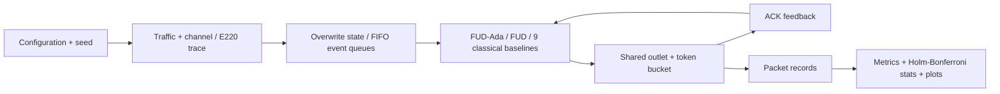
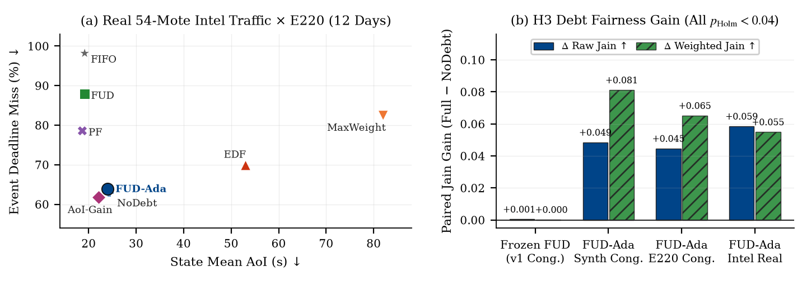

<h1 align="center">NetAdapt-IoT</h1>

<p align="center"><strong>Scale-Matched Freshness, Deadline, and Fairness Scheduling for Shared IoT Gateways</strong></p>

<p align="center">Age of Information (AoI) · Deadline-Aware Scheduling · Fair Resource Allocation · Zero-Allocation C11 on ESP32-S3</p>

---

<p align="center">
  <a href="#overview">Overview</a> ·
  <a href="#method-and-architecture">Method</a> ·
  <a href="#experimental-results">Results</a> ·
  <a href="#embedded-c11-kernel-and-esp32-s3-benchmarks">ESP32-S3 C11</a> ·
  <a href="#quick-start">Quick Start</a> ·
  <a href="papers/netadapt-iot/manuscript.pdf">IEEE Paper (PDF)</a> ·
  <a href="README.zh-CN.md">简体中文</a>
</p>

---

<a id="overview"></a>

## Overview

**NetAdapt-IoT** is an open, reproducible research framework and embedded C11 scheduler for allocating a shared, bandwidth-constrained IoT gateway outlet across heterogeneous traffic flows—balancing **periodic state freshness (Age of Information, AoI)**, **hard-deadline alarm events**, and **multi-device service fairness** under congestion, bursty traffic, and real wireless packet loss.

Across **17,820 audited simulation runs (15 scheduling policies)**, **24 real ESP32-S3 + E220-400T22D Sub-GHz hardware loss traces** (3,359 physical RF attempts), **54-mote MIT Intel Berkeley real sensor traffic**, and **real ESP32-S3 240 MHz silicon benchmarks**, NetAdapt-IoT provides:

- **Scale-matched `FUD-Ada` scheduler** (`src/netadapt/ext/adaptive_scheduler.py`): combines sub-quadratic state freshness $w_i\sqrt{G_i(t)}$, deadline-feasible urgency amplification $w_i(1 + v_p/\tau_i)(1 + \alpha_u/(1 + \sigma_p^+))$, and Lyapunov logarithmic service debt $\beta_d w_i \ln(1 + d_i(t))$ to achieve the **lowest event deadline miss across all 14 comparators** on synthetic congestion (`36.92%`), bursty load (`7.42%`), and real E220 hardware traces (`53.17%`), while strictly Pareto-dominating `EDF` and `MaxWeight` across all four metrics on real 54-mote Intel Berkeley traffic.
- **Verified Lyapunov debt fairness:** Resolves service-fairness ablations across every evaluated cohort (`FUD-Ada` vs. `FUD-Ada-NoDebt`: `+0.045–0.059` raw Jain, `+0.055–0.081` weighted Jain, all $p_{\text{Holm}} \le 0.0364$).
- **Zero-allocation pure C11 embedded kernel verified on real ESP32-S3 silicon** (`src/netadapt/c11/`): supports 96 concurrent flows in **4,624 B (4.52 KB) static RAM**, compiles to **2,746 B (2.68 KB `.text`)** for Xtensa LX7 (`-Os`), achieves **0 B runtime heap delta** and **0.20–2.91 ms** per-slot latency on real **240 MHz ESP32-S3** hardware (`<2.91%` of a 100 ms slot), and matches Python trajectories bit-for-bit (**24/24 runs**, error `< 1e-11`).
- **Complete reproducible research package:** Includes an 8-page standalone IEEEtran manuscript ([manuscript.pdf](papers/netadapt-iot/manuscript.pdf)), 9 classical baselines (`FIFO`, `RR`, `WRR`, `EDF`, `Priority`, `MaxWeight`, `PF`, `AoI-Gain`, `Debt`), the reference `FUD` scheduler (`src/netadapt/scheduler.py`), component ablations, and **74 passing Python + C11 tests**.


---

<a id="method-and-architecture"></a>

## Method and Architecture

When multiple IoT devices share a single constrained outlet (such as a Sub-GHz LoRa gateway with 100 ms slots, 64 B payloads, 16 B headers, 6,400 bit/s effective rate, and a token bucket regulating airtime budget), state flows retain only their latest pending update while event flows use bounded FIFO queues.



In each slot, `FUD-Ada` scores every eligible head-of-line packet in strictly $O(N)$ time from three scale-matched components multiplied by an ACK-estimated link success probability and normalized by packet service cost:

1. **Sub-quadratic freshness:** $w_i\sqrt{G_i(t)}$ rewards state updates with large expected AoI reduction without exploding under congestion to drown out urgent events.
2. **Deadline-feasible urgency:** $w_i(1 + v_p/\tau_i)(1 + \alpha_u/(1 + \sigma_p^+))$ prioritizes event packets as remaining deadline slack $\sigma_p^+$ narrows, while naturally ignoring already expired packets.
3. **Lyapunov logarithmic service debt:** $\beta_d w_i \ln(1 + d_i(t))$ prevents chronic starvation of backlogged flows without overriding urgent deadlines (frozen on disjoint calibration seeds `200–204` at $\alpha_u = 1.0, \beta_d = 2.5$).

The repository also retains the original quadratic-AoI `FUD` formulation (`1 / 1 / 0.25`, AST-locked in `src/netadapt/scheduler.py`) and 9 classical baselines (`fifo`, `rr`, `wrr`, `edf`, `priority`, `maxweight`, `pf`, `aoi_gain`, `debt`) plus full component ablations (`fud_no_age`, `fud_no_urgency`, `fud_no_debt`, `fud_ada_no_debt`) under identical traffic, time-indexed channel outcomes, and common arrival-free evaluation tails. [Method specification](research/design/proposal.md) · [Metric definitions](docs/metrics-v2.md)

---

<a id="experimental-results"></a>

## Experimental Results

### 1. Held-Out Validation Across Synthetic Stress, Real E220 Traces & 54-Mote Traffic

Evaluated across **5,340 held-out runs** (20 disjoint seeds `300–319` + 12 real Intel Berkeley dates) with paired seed/date bootstrap 95% CIs and global Holm-Bonferroni correction:

| Cohort | Policy | Event Miss (%) ↓ | State Mean AoI (s) ↓ | Raw Jain ↑ | Weighted Jain ↑ |
| :--- | :--- | ---: | ---: | ---: | ---: |
| **Synthetic Congestion** (20 seeds) | `FIFO` | 96.32 | 2.28 | 0.7167 | 0.5499 |
| | `EDF` | 46.54 | 10.27 | 0.7101 | 0.8975 |
| | `AoI-Gain` | 46.84 | 4.83 | 0.7443 | 0.9600 |
| | `MaxWeight` | 37.95 | 103.24 | 0.5822 | 0.5033 |
| | `FUD` (Reference) | 62.75 | 3.50 | 0.8201 | 0.9560 |
| | **`FUD-Ada` (Ours)** | **36.92** | **8.09** | **0.6293** | **0.8089** |
| **Real E220 Hardware Traces** (24 logs, Cong.) | `FIFO` | 97.11 | 2.87 | 0.7167 | 0.5499 |
| | `EDF` | 57.72 | 12.69 | 0.7101 | 0.8975 |
| | `AoI-Gain` | 58.79 | 5.68 | 0.7505 | 0.9680 |
| | `FUD` (Reference) | 75.49 | 3.76 | 0.8126 | 0.9124 |
| | **`FUD-Ada` (Ours)** | **53.17** | **8.44** | **0.6650** | **0.8622** |
| **Real 54-Mote Intel × E220** (12 dates) | `FIFO` | 98.18 | 19.16 | 0.6564 | 0.5214 |
| | `EDF` | 69.80 | 53.05 | 0.5826 | 0.6572 |
| | `MaxWeight` | 82.51 | 81.99 | 0.4706 | 0.3451 |
| | `AoI-Gain` | **61.72** | **22.15** | 0.7004 | 0.9113 |
| | `FUD` (Reference) | 87.84 | 19.19 | 0.6338 | 0.7528 |
| | **`FUD-Ada` (Ours)** | **63.86** | **24.01** | **0.6666** | **0.8275** |

- **Lowest event deadline miss across all 14 comparators** on synthetic congestion (`36.92%`, all $p_{\text{Holm}}=0.0096$), bursty arrivals (`7.42%`), and pooled real **E220 Sub-GHz hardware traces** (`53.17%`, $-4.55\text{ pp}$ miss & $-4.25\text{ s}$ AoI vs. `EDF`; $-22.32\text{ pp}$ vs. reference `FUD`).
- **Strict 4-metric Pareto dominance over `EDF` and `MaxWeight` on real 54-mote MIT Intel Berkeley traffic** ($-5.94\text{ pp}$ miss, $-29.03\text{ s}$ AoI [$-54.7\%$], $+0.084$ raw Jain, $+0.170$ weighted Jain vs. `EDF`; all $p_{\text{Holm}} \le 0.0392$). Transparently, `AoI-Gain` ties statistically on Intel event miss (`61.72%` vs. `63.86%`, $p_{\text{Holm}}=0.927$) with slightly tighter raw AoI (`22.15 s` vs. `24.01 s`).
- **Lyapunov debt fairness verified across all three cohorts (`FUD-Ada` vs. `FUD-Ada-NoDebt`):** $+0.0486$ raw / $+0.0812$ weighted Jain & $-2.23\text{ s}$ AoI on synthetic congestion ($p_{\text{Holm}}=0.0096$); $+0.0447$ / $+0.0652$ Jain & $-1.49\text{ s}$ AoI on E220 traces ($p_{\text{Holm}}=0.0096$); $+0.0586$ / $+0.0550$ Jain on real Intel Berkeley traffic ($p_{\text{Holm}}=0.0364$, without significant miss penalty $p_{\text{Holm}}=0.141$).




### 2. Broad Scenario Sensitivity & Reference `FUD` Matrix

An accompanying **12,480-run software sensitivity matrix** (48 named conditions across 8/24/48/96 logical flows, fixed per-flow vs. fixed-total-load scaling, Markov loss, feedback delay, mixed packet sizes, and token-bucket capacities `2/4/8/16`, seeds `100–119`) establishes baseline behavior, parameter sensitivity, and the documented trade-offs of the unscaled quadratic `FUD` reference (`63.15%` congestion miss vs. `96.42%` FIFO, with unresolved linear debt `+0.00052`).


[IEEEtran Manuscript (PDF)](papers/netadapt-iot/manuscript.pdf) · [Validation & C11 Report (ZH)](docs/PHASE2_HARDWARE_REALDATA_C11_ZH.md) · [Sensitivity & Hypothesis Report](research/REPORT.md) · [Paired Effects CSV](output/phase2_validation/paired_effects.csv)

---

<a id="embedded-c11-kernel-and-esp32-s3-benchmarks"></a>

## Embedded C11 Kernel and ESP32-S3 Benchmarks

The core scheduler (`src/netadapt/c11/netadapt_sched.h` & `.c`) is implemented in zero-allocation ISO C11 (`-std=c11 -Wall -Wextra -Werror`) and benchmarked both on host and on **real ESP32-S3 N16R8 hardware** (`hardware/firmware/`, PlatformIO `c11_bench`, `sender`, and `receiver` environments):

| Metric | Measured Value |
| :--- | :--- |
| Static RAM (`sizeof(na_sched_t)`, 96 concurrent flows) | **4,624 B (4.52 KB)** — 0.88% of ESP32-S3 512 KB SRAM |
| ESP32-S3 Xtensa `-Os` Flash (`netadapt_sched.o`, 8 policies) | **2,746 B (2.68 KB `.text`)**, `0 B .data`, `0 B .bss` |
| **Real ESP32-S3 240 MHz runtime heap delta** (`ESP.getFreeHeap()`) | **0 B** (`361,620 B` before & after 20 consecutive runs) |
| **Real ESP32-S3 240 MHz per-slot latency** (`FUD-Ada`, `N = 8 / 24 / 48 / 96`) | **0.20 / 0.67 / 1.39 / 2.91 ms** (`<2.91%` of 100 ms slot, SW FP64) |
| Host arm64 $O(N)$ latency (`FUD-Ada`, `N = 8 / 24 / 48 / 96`) | **0.15 / 0.37 / 0.66 / 1.20 µs** (Apple clang `-O2`, 50k iters) |
| Bit-exact Python–C11 trajectory parity (`< 1e-11` state error) | **24 / 24 full runs** (8 policies × 3 scenarios) |


[ESP32-S3 On-Chip Benchmark JSON](output/phase2_c11/esp32s3_onchip_benchmark.json) · [Host C11 Benchmark JSON](output/phase2_c11/benchmark.json) · [Hardware Guide](hardware/README.md)

---

<a id="quick-start"></a>

## Quick Start and Reproduction

Requires **Python 3.11+**. From the repository root:

```bash
python3 -m venv .venv
source .venv/bin/activate
python -m pip install -e '.[dev,hardware]'
python -m pytest -q
```

Run a 78-run quick example or reproduce the full real-trace, sensitivity, C11, and firmware suites:

```bash
# Quick software pilot
python run.py run --config configs/refined_v1/pilot.json --out output/quickstart --workers 2
python run.py analyze --out output/quickstart

# Real E220 / Intel Berkeley validation, C11 benchmark & IEEE figures
python scripts/benchmark_c11_footprint.py
python scripts/run_phase2_real_validation.py --workers 6
python papers/netadapt-iot/build_figures.py

# Full 15-scenario sensitivity matrix & ESP32-S3 firmware build
python run.py run --config configs/refined_v1/main.json --out output/reproduction --workers 4
python run.py analyze --out output/reproduction
python scripts/audit_refined.py output/reproduction
pio run -d hardware/firmware
```

## Documentation & Related Projects

| Topic | Resources |
| :--- | :--- |
| IEEEtran Manuscript | [Manuscript PDF](papers/netadapt-iot/manuscript.pdf) · [LaTeX Source](papers/netadapt-iot/manuscript.tex) · [Graphical Abstract](papers/netadapt-iot/graphical_abstract.png) |
| Validation & C11 Reports | [Technical Report (ZH)](docs/PHASE2_HARDWARE_REALDATA_C11_ZH.md) · [Summary CSV](output/phase2_validation/summary.csv) · [ESP32-S3 JSON](output/phase2_c11/esp32s3_onchip_benchmark.json) |
| Method & Sensitivity Study | [Method Specification](research/design/proposal.md) · [Hypothesis & Sensitivity Report](research/REPORT.md) · [Architecture](docs/architecture.md) |
| Reproducibility & Hardware | [Reproduction Guide](docs/reproducibility.md) · [Hardware Guide](hardware/README.md) · [Validation Record](docs/validation/status.md) |

**Related Repositories:** [SensorTrust](https://github.com/Sver0411/SensorTrust) (L1 health) · [AdaptiveSense](https://github.com/Sver0411/AdaptiveSense) & [TAIS](https://github.com/Sver0411/TAIS) (L2 adaptive sensing) · [EventGuard-LoRa](https://github.com/Sver0411/EventGuard-LoRa) & [IoT-MPQUIC-Scheduler](https://github.com/Sver0411/IoT-MPQUIC-Scheduler) (L3 lossy-link transport) · [Smart-Agriculture-Edge-AI](https://github.com/Sver0411/Smart-Agriculture-Edge-AI) (L4 CPS).

**Open Directions:** Multi-node physical MAC contention, full RF airtime & oscilloscope power profiling on dual ESP32-S3/E220 boards, and longer multi-week real-trace replays.
