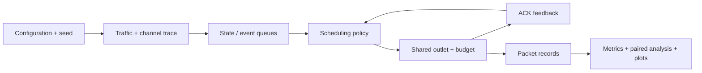
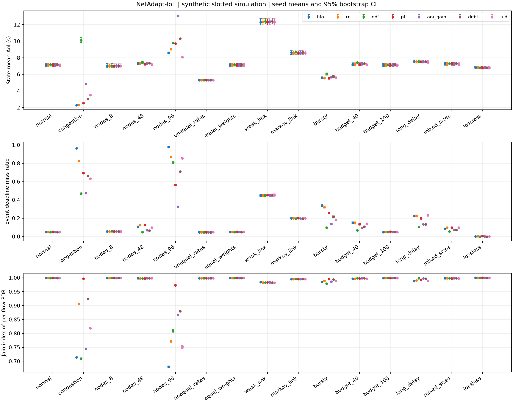
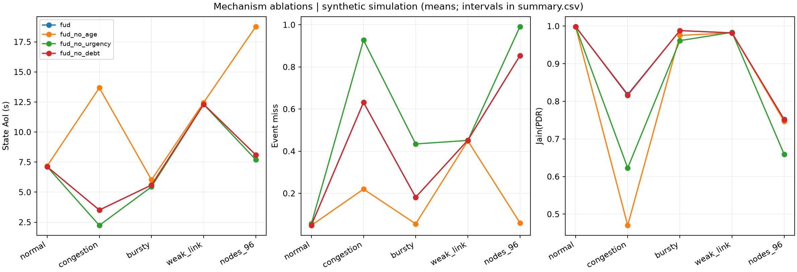

<h1 align="center">NetAdapt-IoT</h1>

<p align="center"><strong>Adaptive Resource Scheduling for Multi-Flow IoT Networks</strong></p>

<p align="center">Age of Information · Deadline-Aware Scheduling · Fair Resource Allocation</p>

---

<p align="center">
  <a href="#project-overview">Overview</a> ·
  <a href="#research-question-and-method">Method</a> ·
  <a href="#key-findings">Results</a> ·
  <a href="#implementation-status">Status</a> ·
  <a href="#quick-start">Quick Start</a> ·
  <a href="README.zh-CN.md">简体中文</a>
</p>

---

<a id="project-overview"></a>

NetAdapt-IoT is a research platform for scheduling multiple IoT traffic flows over a shared communication outlet. It studies how limited network resources can be allocated among fresh state updates, deadline-sensitive events, and devices with different service requirements.

The project combines a Python slotted network simulator, nine baseline schedulers, the Freshness–Urgency–Debt (FUD) policy, three mechanism ablations, and an automated experiment pipeline. The current software evaluation contains **3,900 runs across 15 scenarios and 20 seeds**, with packet-level records, paired statistics, and comparison figures. An ESP32-S3/E220 firmware pair and PC replay tool support the next stage of single-link experiments.

<a id="research-question-and-method"></a>

## Research question and method

How should a shared IoT gateway schedule mixed traffic to balance information freshness, event deadlines, and service fairness as load and link conditions change?

FUD makes each scheduling decision from three components:

1. **Freshness:** the expected normalized squared-AoI reduction from delivering a state update.
2. **Urgency:** the remaining deadline slack and waiting time of an event packet.
3. **Debt:** the accumulated service demand of backlogged flows.

The scheduler combines these components with an ACK-based success estimate and packet service cost, then selects an eligible head-of-line packet. The component coefficients are `1 / 1 / 0.25`. The decision scan takes `O(N)` time for `N` flows; queue expiration is handled separately.

State flows keep their newest waiting update. Event flows use bounded FIFO queues. A token bucket regulates the communication budget, and the shared server completes one non-preemptive transmission at a time.



The default simulation uses 100 ms slots, 64-byte payloads, a 16-byte abstract header, and a 6,400 bit/s effective service rate. The token bucket holds four service slots. The [method specification](research/design/proposal.md) defines the score, queue rules, timing, and metrics.

## Baselines and experiment design

| Policy | Scheduling principle |
| --- | --- |
| `fifo` | Oldest eligible head-of-line packet |
| `rr` / `wrr` | Round robin / weighted round robin |
| `edf` / `priority` | Earliest deadline / fixed business priority |
| `maxweight` / `pf` | Queue pressure / proportional fairness |
| `aoi_gain` / `debt` | Freshness gain / accumulated service debt |
| `fud` | Combined freshness, urgency, and debt |
| `fud_no_age` / `fud_no_urgency` / `fud_no_debt` | Individual component ablations |

Each scenario/seed group gives all 13 methods the same traffic, time-indexed potential channel outcomes, queue rules, and resource budget. Scheduling uses packet timestamps, queue state, and past ACK observations.

The 15 scenarios cover normal load, congestion, 8/24/48/96 logical devices, unequal source rates, equal priorities, weak links, Markov losses, bursts, resource-budget changes, feedback delay, mixed packet sizes, and lossless service.

Evaluation tracks state AoI, event deadline miss ratio, packet delivery ratio, average/P95 latency, goodput, queue length, service utilization, and Jain fairness of per-flow delivery ratios. Full definitions and parameters are in the [experiment protocol](research/experiments/protocol.md) and [study configuration](configs/study.json).

<a id="key-findings"></a>

## Key findings: software evaluation

The final matrix contains **15 scenarios × 20 seeds (100–119) × 13 methods = 3,900 simulation runs**. Each run uses 4,000 slots and a 500-slot warmup. Event metrics use a guarded generation cohort; confidence intervals resample paired seed differences.

| Scenario | Policy | State mean AoI (s) ↓ | Event deadline miss (%) ↓ | Jain(PDR) ↑ |
| --- | --- | ---: | ---: | ---: |
| Congestion | FIFO | 2.2841 | 96.42 | 0.7140 |
| Congestion | AoI-gain | 4.8532 | 47.33 | 0.7449 |
| Congestion | FUD | 3.5046 | 63.18 | 0.8184 |
| Bursty | FIFO | 5.5966 | 33.96 | 0.9851 |
| Bursty | AoI-gain | 5.6617 | 13.85 | 0.9861 |
| Bursty | FUD | 5.5926 | 18.15 | 0.9882 |

**Congestion:** compared with FIFO, FUD reduces event misses by 33.24 percentage points and increases state AoI by 1.22049 s. Compared with AoI-gain, it achieves lower state AoI and higher Jain(PDR), while more events miss their deadlines.

**Bursty traffic:** compared with FIFO, FUD reduces event misses by 15.81 percentage points. The AoI difference is −0.00394 s, with a 95% paired bootstrap interval of `[−0.03330, +0.02285]` s.

**Mechanism ablation:** adding debt changes Jain(PDR) by approximately +0.00196 under congestion and −0.00010 under bursts. Its contribution depends on the workload.





The figures show how freshness, timely delivery, and fairness move together across workloads. All 13 methods are included in the [summary](output/study/summary.csv), [paired comparisons](output/study/paired_differences.csv), and [per-flow results](output/study/per_flow.csv). The [results report](output/study/results.md) and [negative-results table](output/study/negative_results.csv) retain the full comparison set.

<a id="implementation-status"></a>

## Implementation status

| Component | Progress |
| --- | --- |
| Traffic generation, queues, channel model, and 13 scheduling methods | Implemented; software-tested |
| Automated experiment runner and statistical analysis | 3,900 completed runs; zero execution failures |
| Python unit and integration checks | 34 tests passed |
| Dataset audit | 3,900 runs checked; 300 shared-trace groups verified |
| Deterministic replay | Five representative FUD runs reproduced with identical metrics |
| PC serial protocol and logical-flow replay | Implemented; mocked serial tests passed |
| ESP32-S3 N16R8 sender and receiver firmware | Both PlatformIO builds passed |
| Physical single-link calibration and experiments | Next stage |

The hardware path uses two ESP32-S3 boards and two E220-400T22S radios. The PC schedules logical flows through the sender, and the receiver validates CRC-protected frames and returns ACKs. Setup and capture commands are in the [hardware guide](hardware/README.md). Build logs and software checks are collected in the [validation record](docs/validation/status.md).

<a id="quick-start"></a>

## Quick start and reproduction

Use Python 3.11 or newer. From the project directory:

```bash
python3 -m venv .venv
source .venv/bin/activate
python -m pip install -e '.[dev,hardware]'
python -m pytest -q
```

Run the 52-run software example and generate its report:

```bash
python run.py run --config configs/pilot.json --out output/quickstart --workers 2
python run.py analyze --out output/quickstart
```

Run the full experiment matrix:

```bash
python run.py run --config configs/study.json --out output/reproduction --workers 4
python run.py analyze --out output/reproduction
```

Choose a new output directory for each fresh experiment. Matching source hashes and configurations allow an existing experiment to resume. The `hardware` extra includes serial-test dependencies and PlatformIO.

Audit the reproduced dataset or build the firmware:

```bash
python scripts/audit_study.py output/reproduction
pio run -d hardware/firmware
```

Each run saves its configuration, seed, source/trace hashes, packet outcomes, and scheduling decisions. Analysis adds CSV summaries, paired bootstrap intervals, PNG figures, and a Markdown report. Environment details are recorded in [requirements-lock.txt](requirements-lock.txt) and the experiment [manifest](output/study/manifest.json).

The repository includes experiment summaries, per-flow tables, reports, and figures. Packet-level logs and historical source snapshots remain in the local output directories; the experiment commands regenerate packet records from the saved configurations.

## Related research projects

| Project | Research focus |
| --- | --- |
| [AdaptiveSense](https://github.com/Sver0411/AdaptiveSense) | Change-aware sampling and upload decisions |
| [SensorTrust](https://github.com/Sver0411/SensorTrust) | Sensor health assessment and fault detection |
| [EventGuard-LoRa](https://github.com/Sver0411/EventGuard-LoRa) | Critical-event delivery and bounded communication redundancy |
| [Smart-Agriculture-Edge-AI](https://github.com/Sver0411/Smart-Agriculture-Edge-AI) | Multi-node sensing, edge decisions, and offline recovery |

NetAdapt-IoT focuses on network-level service ordering. It keeps source generation fixed and studies how multiple devices and business flows share communication opportunities.

## Documentation and roadmap

| Topic | Documentation |
| --- | --- |
| Method and equations | [Research proposal](research/design/proposal.md) |
| Experiment design | [Protocol](research/experiments/protocol.md) · [Configuration](configs/study.json) |
| Software structure | [Architecture](docs/architecture.md) |
| Results and data | [Results report](output/study/results.md) · [Summary CSV](output/study/summary.csv) |
| Reproduction and auditing | [Reproduction guide](docs/reproducibility.md) · [Audit](output/study/audit.json) |
| Hardware and development | [Hardware guide](hardware/README.md) · [Roadmap](docs/roadmap.md) |

Next development priorities:

- Calibrate single-frame transmission, ACK timing, and effective service rate on the ESP32-S3/E220 link.
- Replay shared logical-flow workloads through the physical outlet.
- Extend experiments to independent sending nodes and network access control.
- Evaluate longer traffic traces, additional scheduling methods, and measured communication energy.
