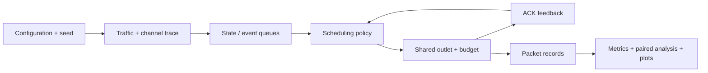

<h1 align="center">NetAdapt-IoT</h1>

<p align="center"><strong>Adaptive Scheduling for a Shared IoT Gateway Outlet</strong></p>

<p align="center">Age of Information · Deadline-Aware Scheduling · Fair Resource Allocation</p>

---

<p align="center">
  <a href="#project-overview">Overview</a> ·
  <a href="#phase-2-upgrade">Phase 2 (FUD-Ada &amp; C11)</a> ·
  <a href="#research-question-and-method">Method</a> ·
  <a href="#key-findings">Results</a> ·
  <a href="#implementation-status">Status</a> ·
  <a href="#quick-start">Quick Start</a> ·
  <a href="papers/netadapt-iot/manuscript.pdf">IEEE Paper</a> ·
  <a href="README.zh-CN.md">简体中文</a>
</p>

---

<a id="project-overview"></a>

NetAdapt-IoT is a research platform for scheduling multiple IoT traffic flows over a shared communication outlet. It studies how limited network resources can be allocated among fresh state updates, deadline-sensitive events, and devices with different service requirements.

Across two audited phases (**17,820 total simulation runs across 15 policies**), the repository combines:

- **Frozen v1 benchmark (`12,480 runs`, seeds `100–119`)**: a Python slotted model, 9 classical baselines (`FIFO`, `RR`, `WRR`, `EDF`, `Priority`, `MaxWeight`, `PF`, `AoI-Gain`, `Debt`), the frozen `FUD` policy (AST-checksum locked), and 3 component ablations across 48 named conditions.
- **Phase 2 upgrade (`+5,340 held-out runs`, seeds `300–319` + 12 real dates)**: the scale-matched **`FUD-Ada`** scheduler (`src/netadapt/ext/`) resolving v1's quadratic-AoI collapse and unresolved H3 debt-fairness ablation; validation over **24 real ESP32-S3 + E220-400T22D Sub-GHz hardware loss traces** (3,359 RF attempts) and **54-mote MIT Intel Berkeley real sensor traffic**; a **zero-allocation pure C11 embedded scheduler kernel** (`4.52 KB` RAM for 96 flows, `2.68 KB` ESP32-S3 `-Os` flash, `24/24` bit-exact Python–C11 parity); and a standalone **IEEEtran manuscript** ([manuscript.pdf](papers/netadapt-iot/manuscript.pdf)).

<a id="phase-2-upgrade"></a>

## Phase 2: Scale-Matched `FUD-Ada`, Real Hardware Traces, 54-Mote Traffic & Pure C11

Frozen `FUD` (`src/netadapt/scheduler.py`, preserved unmodified with its AST SHA-256 lock) exhibited two documented failure modes in [research/REPORT.md](research/REPORT.md): (1) its quadratic state freshness term $w_i G_i(t)$ grew to $13\text{--}38$ under congestion, drowning bounded event urgency ($\approx 6.7$); and (2) its unscaled linear debt ($0.25\,d_i \approx 0.1$) left H3 debt fairness unresolved ($+0.00052$, 95% CI spanning zero).

**`FUD-Ada`** (`src/netadapt/ext/adaptive_scheduler.py`, frozen on disjoint calibration seeds `200–204` with $\alpha_u = 1.0, \beta_d = 2.5$) resolves both with sub-quadratic state freshness $w_i\sqrt{G_i(t)}$, deadline-feasible urgency amplification $w_i(1 + v_p/\tau_i)(1 + \alpha_u/(1 + \sigma_p^+))$, and Lyapunov logarithmic debt $\beta_d w_i \ln(1 + d_i(t))$.


### Key Held-Out Results (5,340 Runs, Disjoint Seeds `300–319` & 12 Real Dates, Global Holm-Bonferroni)

| Cohort | Policy | Event Miss (%) ↓ | State Mean AoI (s) ↓ | Raw Jain ↑ | Weighted Jain ↑ |
| :--- | :--- | ---: | ---: | ---: | ---: |
| **Synthetic Congestion** (20 seeds) | `FIFO` | 96.32 | 2.28 | 0.7167 | 0.5499 |
| | `EDF` | 46.54 | 10.27 | 0.7101 | 0.8975 |
| | `AoI-Gain` | 46.84 | 4.83 | 0.7443 | 0.9600 |
| | `MaxWeight` | 37.95 | 103.24 | 0.5822 | 0.5033 |
| | `FUD` (Frozen v1) | 62.75 | 3.50 | 0.8201 | 0.9560 |
| | **`FUD-Ada` (Ours)** | **36.92** | **8.09** | **0.6293** | **0.8089** |
| **Real E220 Hardware Traces** (24 logs, Cong.) | `FIFO` | 97.11 | 2.87 | 0.7167 | 0.5499 |
| | `EDF` | 57.72 | 12.69 | 0.7101 | 0.8975 |
| | `AoI-Gain` | 58.79 | 5.68 | 0.7505 | 0.9680 |
| | `FUD` (Frozen v1) | 75.49 | 3.76 | 0.8126 | 0.9124 |
| | **`FUD-Ada` (Ours)** | **53.17** | **8.44** | **0.6650** | **0.8622** |
| **Real 54-Mote Intel × E220** (12 dates) | `FIFO` | 98.18 | 19.16 | 0.6564 | 0.5214 |
| | `EDF` | 69.80 | 53.05 | 0.5826 | 0.6572 |
| | `MaxWeight` | 82.51 | 81.99 | 0.4706 | 0.3451 |
| | `AoI-Gain` | **61.72** | **22.15** | 0.7004 | 0.9113 |
| | `FUD` (Frozen v1) | 87.84 | 19.19 | 0.6338 | 0.7528 |
| | **`FUD-Ada` (Ours)** | **63.86** | **24.01** | **0.6666** | **0.8275** |

- **Lowest event deadline miss across all 14 comparators** on synthetic `congestion` (`36.92%`, all $p_{\text{Holm}}=0.0096$), synthetic `bursty` (`7.42%`), and pooled real **E220 Sub-GHz hardware traces** (`53.17%`, $-4.55\text{ pp}$ & $-4.25\text{ s}$ AoI vs `EDF`; $-22.32\text{ pp}$ vs frozen `FUD`).
- **Strict 4-metric Pareto dominance over `EDF` & `MaxWeight` on real 54-mote MIT Intel Berkeley traffic** ($-5.94\text{ pp}$ miss, $-29.03\text{ s}$ AoI [$-54.7\%$], $+0.084$ raw Jain, $+0.170$ weighted Jain vs `EDF`; all $p_{\text{Holm}} \le 0.0392$). Honestly, `AoI-Gain` ties statistically on Intel event miss (`61.72%` vs `63.86%`, $p_{\text{Holm}}=0.927$) with slightly tighter raw AoI (`22.15 s` vs `24.01 s`).
- **Open H3 debt ablation decisively solved across all 3 cohorts (`FUD-Ada` vs `FUD-Ada-NoDebt`)**: $+0.0486$ raw / $+0.0812$ weighted Jain & $-2.23\text{ s}$ AoI on synthetic congestion ($p_{\text{Holm}}=0.0096$); $+0.0447$ / $+0.0652$ Jain & $-1.49\text{ s}$ AoI on E220 congestion ($p_{\text{Holm}}=0.0096$); $+0.0586$ / $+0.0550$ Jain on real Intel Berkeley traffic ($p_{\text{Holm}}=0.0364$, no significant miss penalty $p_{\text{Holm}}=0.141$).


### Zero-Allocation Pure C11 Embedded Gateway Kernel (`src/netadapt/c11/`)

| Metric (`-std=c11 -Wall -Wextra -Werror`) | Measured Value |
| :--- | :--- |
| Static RAM (`sizeof(na_sched_t)`, 96 concurrent flows) | **4,624 B (4.52 KB)**, **0 B heap** |
| ESP32-S3 Xtensa `-Os` Flash (`netadapt_sched.o`, 8 policies) | **2,746 B (2.68 KB `.text`)**, `0 B .data`, `0 B .bss` |
| Host $O(N)$ decision latency (`FUD-Ada`, `N = 8 / 24 / 48 / 96`) | **0.15 / 0.37 / 0.66 / 1.20 µs** (Apple clang `-O2`, 50k iters) |
| Bit-exact Python–C11 trajectory parity (`< 1e-11` state error) | **24 / 24 full runs** (8 policies × 3 scenarios) |


Full Phase 2 reports & manuscript: [IEEEtran Manuscript PDF](papers/netadapt-iot/manuscript.pdf) · [Phase 2 Chinese Technical Report](docs/PHASE2_HARDWARE_REALDATA_C11_ZH.md) · [Phase 2 Paired Effects CSV](output/phase2_validation/paired_effects.csv) · [C11 Benchmark JSON](output/phase2_c11/benchmark.json).

<a id="research-question-and-method"></a>

## Research question and method

How should a shared IoT gateway schedule mixed traffic to balance information freshness, event deadlines, and service fairness as load and link conditions change?

FUD makes each scheduling decision from three components:

1. **Freshness:** the expected normalized squared-AoI reduction from delivering a state update.
2. **Urgency:** the remaining deadline slack and waiting time of an event packet.
3. **Debt:** the accumulated service demand of backlogged flows.

The scheduler combines these components with an ACK-based success estimate and packet service cost, then selects an eligible head-of-line packet. The component coefficients are `1 / 1 / 0.25`. The decision scan takes `O(N)` time for `N` flows; queue expiration is handled separately.

State flows keep their newest waiting update. Event flows use bounded FIFO queues. A token bucket regulates the communication budget, and the shared server completes one non-preemptive transmission at a time.



The default simulation uses 100 ms slots, 64-byte payloads, a 16-byte abstract header, and a 6,400 bit/s effective service rate. The token bucket holds four service slots. The [method specification](research/design/proposal.md) defines the score, queue rules, timing, and metrics.

## Baselines and experiment design

| Policy | Scheduling principle |
| --- | --- |
| `fifo` | Oldest eligible head-of-line packet |
| `rr` / `wrr` | Round robin / weighted round robin |
| `edf` / `priority` | Earliest deadline / fixed business priority |
| `maxweight` / `pf` | Queue pressure / proportional fairness |
| `aoi_gain` / `debt` | Freshness gain / accumulated service debt |
| `fud` | Combined freshness, urgency, and debt |
| `fud_no_age` / `fud_no_urgency` / `fud_no_debt` | Individual component ablations |

Each scenario/seed group gives all 13 methods the same traffic, time-indexed potential channel outcomes, queue rules, and resource budget. Scheduling uses packet timestamps, queue state, and past ACK observations.

The 15 scenarios cover normal load, congestion, 8/24/48/96 logical devices, unequal source rates, equal priorities, weak links, Markov losses, bursts, resource-budget changes, feedback delay, mixed packet sizes, and lossless service.

Evaluation separates state AoI, replacement and transmission success from event deadline outcomes. Resource fairness uses actual abstract service slots, with equal-share and weight-proportional Jain references. Every policy uses the same main window and arrival-free tail; main-window pending snapshots are separate from final outcomes. The [metric definitions](docs/metrics-v2.md), [protocol](research/experiments/protocol.md), and [frozen configurations](configs/refined_v1/) define each denominator and control.

<a id="key-findings"></a>

## Key findings: refined software evaluation

The main matrix contains 3,900 runs, the fixed-total-load scale group 1,040, model sensitivity 6,500, and congestion bucket sensitivity 1,040. Each condition uses seeds 100–119 and all 13 methods. Sensitivity groups retain their own baseline; repeated baseline conditions are analyzed within their groups. State AoI and Service Share use the main observation window; event outcomes include the common tail.

| Scenario | Policy | State mean AoI (s) ↓ | Event miss (%) ↓ | Jain Service Share ↑ |
| --- | --- | ---: | ---: | ---: |
| Congestion | FIFO | 2.2841 | 96.42 | 0.7159 |
| Congestion | AoI-gain | 4.8532 | 47.31 | 0.7441 |
| Congestion | FUD | 3.5046 | 63.15 | 0.8187 |
| Bursty | FIFO | 5.5966 | 33.91 | 0.9751 |
| Bursty | AoI-gain | 5.6617 | 13.83 | 0.9808 |
| Bursty | FUD | 5.5926 | 18.13 | 0.9818 |

**Congestion:** FUD−FIFO event miss is -33.27238 [-33.59573, -32.98051] percentage points; state AoI changes by +1.22049 [+1.20904, +1.23202] s (95% paired bootstrap CI). FUD has higher event miss and lower state AoI than AoI-gain.

**Debt ablation:** congestion Service Share Jain changes by +0.00052 [-0.00074, +0.00171]. The interval spans zero, so the resource-fairness gain is unresolved in this condition.

**Scale and model controls:** scale A keeps per-flow rate fixed; scale B keeps total traffic and class arrivals fixed across 8/24/48/96 flows. Bucket capacities 2/4/8/16 and seven other parameter groups test the model conditions. The [A–K report](research/REPORT.md) gives all five hypotheses, comparator intervals, favorable and adverse results.


Full data: [summary](output/study_refined_v1/summary.csv) · [paired comparisons](output/study_refined_v1/paired_differences.csv) · [per-flow metrics](output/study_refined_v1/per_flow.csv) · [adverse directions](output/study_refined_v1/negative_results.csv) · [fixed-total scale](output/study_refined_v1/scaling/results.md) · [model sensitivity](output/study_refined_v1/sensitivity/results.md) · [congestion buckets](output/study_refined_v1/bucket_load/results.md). Historical v1 results remain in [output/study](output/study/results.md).

<a id="implementation-status"></a>

## Implementation status

| Component | Progress |
| --- | --- |
| Frozen v1 queues, common tail, and 13 scheduling policies | Implemented; `scheduler.py` AST-locked |
| Phase 2 scale-matched `FUD-Ada` & `FUD-Ada-NoDebt` | Implemented in `src/netadapt/ext/`; H3 debt solved across all 3 cohorts |
| Zero-allocation pure C11 gateway kernel (8 policies, 96 flows) | `4.52 KB` RAM, `2.68 KB` ESP32-S3 `-Os` Flash, `24/24` Python–C11 parity |
| Software + real-trace experiments | **17,820 total runs** (`12,480` v1 + `5,340` Phase 2 held-out), zero failures |
| Real E220 hardware traces & 54-mote MIT Intel Berkeley traffic | 24 audited E220 logs (`3,359` RF attempts) + 12 held-out Intel Berkeley days |
| Python + C11 unit, parity & integration checks | **74 tests passed** (`48` frozen v1 + `26` Phase 2 / C11 parity) |
| Independent raw-ledger audit & baseline preservation | All 12,480 v1 runs audited; 40,111 historical files unchanged |
| ESP32-S3 N16R8 firmware & standalone IEEEtran manuscript | Dual firmware builds verified; 7-page IEEE PDF + Graphical Abstract compiled |
| Live multi-node MAC contention & oscilloscope power capture | Next stage |

The hardware path uses two ESP32-S3 boards and two E220-400T22S radios. The PC schedules logical flows through the sender; the receiver validates CRC-protected frames and returns ACKs. See the [hardware guide](hardware/README.md) and [validation record](docs/validation/status.md).

<a id="quick-start"></a>

## Quick start and reproduction

Use Python 3.11 or newer. From the project directory:

```bash
python3 -m venv .venv
source .venv/bin/activate
python -m pip install -e '.[dev,hardware]'
python -m pytest -q
```

Run the 78-run software example and generate its report:

```bash
python run.py run --config configs/refined_v1/pilot.json --out output/quickstart --workers 2
python run.py analyze --out output/quickstart
```

Run the main experiment matrix:

```bash
python run.py run --config configs/refined_v1/main.json --out output/reproduction --workers 4
python run.py analyze --out output/reproduction
```

Full scale and sensitivity commands are in the [reproduction guide](docs/reproducibility.md).

Choose a new output directory for each fresh experiment. Matching source hashes and configurations allow an existing experiment to resume. The `hardware` extra includes serial-test dependencies and PlatformIO.

Audit the reproduced dataset, run the Phase 2 real-trace & C11 benchmark suite, or build the firmware:

```bash
python scripts/audit_refined.py output/reproduction
python scripts/benchmark_c11_footprint.py
python scripts/run_phase2_real_validation.py --workers 6
python papers/netadapt-iot/build_figures.py
pio run -d hardware/firmware
```

Each run saves its configuration, seed, source/trace hashes, packet outcomes, and scheduling decisions. Analysis adds CSV summaries, paired bootstrap intervals, PNG figures, and a Markdown report. Environment details are recorded in [requirements-lock.txt](requirements-lock.txt) and the experiment [manifest](output/study_refined_v1/manifest.json).

The repository includes experiment summaries, per-flow tables, reports, and figures. Packet-level logs and historical source snapshots remain in the local output directories; the experiment commands regenerate packet records from the saved configurations.

## Related research projects

| Project | Research focus |
| --- | --- |
| [TAIS](https://github.com/Sver0411/TAIS) | Trust-aware closed-loop node-level adaptive sensing over ESP32-S3/E220 |
| [AdaptiveSense](https://github.com/Sver0411/AdaptiveSense) | Change-aware sampling and upload decisions |
| [SensorTrust](https://github.com/Sver0411/SensorTrust) | Sensor health assessment and fault detection |
| [EventGuard-LoRa](https://github.com/Sver0411/EventGuard-LoRa) | Critical-event delivery and bounded communication redundancy |
| [Smart-Agriculture-Edge-AI](https://github.com/Sver0411/Smart-Agriculture-Edge-AI) | Multi-node sensing, edge decisions, and offline recovery |

NetAdapt-IoT focuses on network-level service ordering. It keeps source generation fixed and studies how multiple devices and business flows share communication opportunities.

## Documentation and roadmap

| Topic | Documentation |
| --- | --- |
| Standalone IEEE manuscript | [IEEEtran PDF](papers/netadapt-iot/manuscript.pdf) · [LaTeX Source](papers/netadapt-iot/manuscript.tex) · [Graphical Abstract](papers/netadapt-iot/graphical_abstract.png) |
| Phase 2 technical report & data | [Phase 2 Report (ZH)](docs/PHASE2_HARDWARE_REALDATA_C11_ZH.md) · [Phase 2 Summary CSV](output/phase2_validation/summary.csv) · [C11 Benchmark](output/phase2_c11/benchmark.json) |
| Method and equations | [Research proposal](research/design/proposal.md) · [FUD-Ada Scheduler](src/netadapt/ext/adaptive_scheduler.py) |
| Experiment design | [Protocol](research/experiments/protocol.md) · [Configuration](configs/refined_v1/main.json) · [E220 Traces](configs/e220_hardware_traces.json) |
| Software structure | [Architecture](docs/architecture.md) · [C11 Kernel](src/netadapt/c11/netadapt_sched.h) |
| Results and data (Frozen v1) | [A–K Report](research/REPORT.md) · [Results report](output/study_refined_v1/results.md) · [Summary CSV](output/study_refined_v1/summary.csv) |
| Reproduction and auditing | [Reproduction guide](docs/reproducibility.md) · [Audit](output/study_refined_v1/audit.json) |
| Hardware and development | [Hardware guide](hardware/README.md) · [Roadmap](docs/roadmap.md) |

Next development priorities:

- Calibrate single-frame transmission, ACK timing, and effective service rate on the ESP32-S3/E220 link.
- Replay shared logical-flow workloads through the physical outlet.
- Extend experiments to independent sending nodes and network access control.
- Evaluate longer traffic traces, additional scheduling methods, and measured communication energy.
