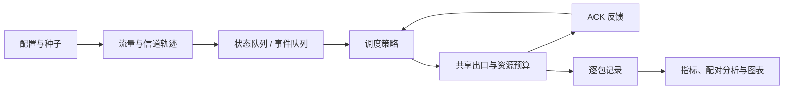
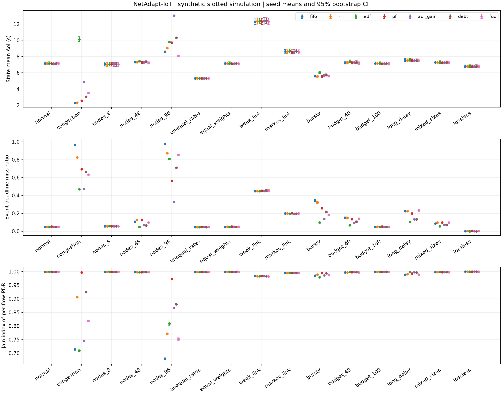
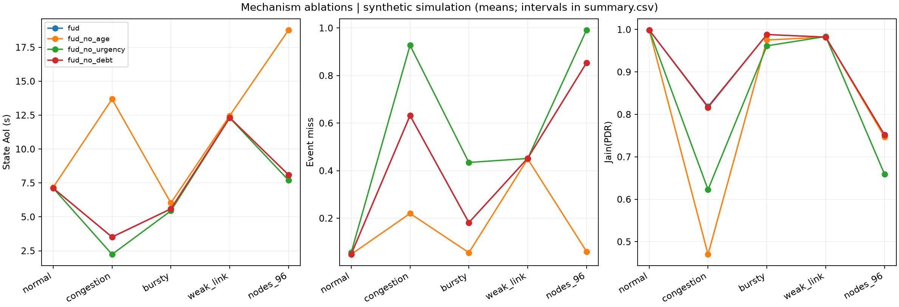

<h1 align="center">NetAdapt-IoT</h1>

<p align="center"><strong>面向多业务物联网网络的自适应资源调度研究</strong></p>

<p align="center">信息年龄 AoI · 截止期感知调度 · 公平资源分配</p>

---

<p align="center">
  <a href="#project-overview">概览</a> ·
  <a href="#research-question-and-method">研究方法</a> ·
  <a href="#key-findings">实验结果</a> ·
  <a href="#implementation-status">实现状态</a> ·
  <a href="#quick-start">快速开始</a> ·
  <a href="README.md">English</a>
</p>

---

<a id="project-overview"></a>

NetAdapt-IoT 是一个面向多业务 IoT 网络的资源调度研究平台，研究多个设备共享有限通信出口时，如何在状态更新的新鲜度、事件截止期和设备服务公平性之间分配资源。

项目包含 Python 离散时隙网络仿真器、九种基线调度方法、Freshness–Urgency–Debt（FUD）组合策略、三种机制消融和自动化实验流程。当前软件评估覆盖 **15 个场景、20 个种子和 3,900 次运行**，保存逐包记录、配对统计和对比图表。ESP32-S3/E220 双端固件及 PC 重放工具用于下一阶段的单链路实验。

<a id="research-question-and-method"></a>

## 研究问题与方法

当负载与链路条件变化时，共享 IoT 网关应该怎样安排不同业务的发送顺序，兼顾信息时效、事件截止期与服务公平性？

FUD 的每次调度决策包含三个部分：

1. **信息时效 Freshness：** 交付状态更新后，预期归一化平方 AoI 的下降量。
2. **事件紧迫度 Urgency：** 事件包的剩余截止期余量与等待时间。
3. **服务欠账 Debt：** 积压业务流累积的服务需求。

调度器结合三个分量、基于 ACK 的成功率估计和包服务成本，选择满足预算的队首包。三个分量系数为 `1 / 1 / 0.25`。对于 `N` 条业务流，每次决策扫描的复杂度为 `O(N)`，队列过期处理另计。

状态流保留最新待发更新，事件流使用有限 FIFO。Token 桶管理通信预算，共享服务器每次完成一个不可抢占的传输。



默认仿真采用 100 ms 时隙、64 B payload、16 B 抽象头部和 6,400 bit/s 有效服务率，Token 桶容量为四个服务时隙。[方法说明](research/design/proposal.md)给出了评分公式、队列规则、时间顺序和指标定义。

## 基线与实验设计

| 方法 | 调度依据 |
| --- | --- |
| `fifo` | 最早产生且满足预算的队首包 |
| `rr` / `wrr` | 轮询 / 加权轮询 |
| `edf` / `priority` | 最早截止期 / 固定业务优先级 |
| `maxweight` / `pf` | 队列压力 / 比例公平 |
| `aoi_gain` / `debt` | 信息时效收益 / 累积服务欠账 |
| `fud` | 结合信息时效、紧迫度与欠账 |
| `fud_no_age` / `fud_no_urgency` / `fud_no_debt` | 分别去除一个分量的消融实验 |

每组场景与种子下，13 种方法使用相同的输入流量、按绝对时刻索引的潜在信道结果、队列规则和资源预算。调度依据包括包时间戳、队列状态与历史 ACK 观测。

15 个场景覆盖正常负载、拥塞、8/24/48/96 个逻辑设备、异构产生率、等优先级、弱链路、Markov 损失、突发、预算变化、反馈延迟、异包长和无损服务。

评价指标包括状态 AoI、事件截止期 miss、包交付率、平均/P95 时延、有效吞吐、队列长度、服务利用率，以及按每流交付率计算的 Jain 公平性。完整定义与参数见[实验协议](research/experiments/protocol.md)和[实验配置](configs/study.json)。

<a id="key-findings"></a>

## 主要发现：软件评估

最终矩阵包含 **15 场景 × 20 个种子（100–119）× 13 方法 = 3,900 次仿真**。每次运行 4,000 slots，预热阶段为 500 slots。事件指标采用预留尾部窗口的生成 cohort，置信区间按配对种子差值重采样。

| 场景 | 方法 | 状态平均 AoI（s）↓ | 事件截止期 miss（%）↓ | Jain(PDR) ↑ |
| --- | --- | ---: | ---: | ---: |
| 拥塞 | FIFO | 2.2841 | 96.42 | 0.7140 |
| 拥塞 | AoI-gain | 4.8532 | 47.33 | 0.7449 |
| 拥塞 | FUD | 3.5046 | 63.18 | 0.8184 |
| 突发 | FIFO | 5.5966 | 33.96 | 0.9851 |
| 突发 | AoI-gain | 5.6617 | 13.85 | 0.9861 |
| 突发 | FUD | 5.5926 | 18.15 | 0.9882 |

**拥塞场景：** 相比 FIFO，FUD 的事件 miss 降低 33.24 个百分点，状态 AoI 增加 1.22049 s。相比 AoI-gain，FUD 的状态 AoI 更低、Jain(PDR) 更高，同时有更多事件超过截止期。

**突发流量：** 相比 FIFO，FUD 的事件 miss 降低 15.81 个百分点。AoI 配对差值为 −0.00394 s，95% 配对 bootstrap 区间为 `[−0.03330, +0.02285]` s。

**机制消融：** 加入欠账项后，拥塞场景的 Jain(PDR) 变化约为 +0.00196，突发场景约为 −0.00010，体现了该机制对负载条件的依赖。





图表展示不同负载下信息时效、及时交付和公平性的变化。全部 13 种方法保存在[统计汇总](output/study/summary.csv)、[配对比较](output/study/paired_differences.csv)和[每流结果](output/study/per_flow.csv)中。[结果报告](output/study/results.md)与[负面结果表](output/study/negative_results.csv)保留完整比较。

<a id="implementation-status"></a>

## 实现状态

| 模块 | 进展 |
| --- | --- |
| 流量生成、队列、信道模型与 13 种调度方法 | 已实现，通过软件测试 |
| 自动化实验运行与统计分析 | 完成 3,900 次运行，执行失败数为 0 |
| Python 单元与集成检查 | 34 项测试通过 |
| 数据审计 | 检查 3,900 次运行，验证 300 组共享轨迹 |
| 确定性重放 | 五个代表场景的 FUD 指标逐字段复现 |
| PC 串口协议与逻辑流重放 | 已实现，模拟串口测试通过 |
| ESP32-S3 N16R8 发送端与接收端固件 | 两种角色均通过 PlatformIO 构建 |
| 物理单链路校准与实验 | 下一阶段 |

硬件路径使用两块 ESP32-S3 和两块 E220-400T22S。PC 将逻辑流调度到发送端，接收端校验带 CRC 的帧并回复 ACK。[硬件指南](hardware/README.md)提供接线与采集命令，[验证记录](docs/validation/status.md)汇总构建日志和软件检查。

<a id="quick-start"></a>

## 快速开始与复现

使用 Python 3.11 或更新版本，从项目目录创建环境：

```bash
python3 -m venv .venv
source .venv/bin/activate
python -m pip install -e '.[dev,hardware]'
python -m pytest -q
```

运行包含 52 次仿真的软件示例，并生成报告：

```bash
python run.py run --config configs/pilot.json --out output/quickstart --workers 2
python run.py analyze --out output/quickstart
```

运行完整实验矩阵：

```bash
python run.py run --config configs/study.json --out output/reproduction --workers 4
python run.py analyze --out output/reproduction
```

每个新实验使用新输出目录；源码 hash 与配置一致时，可恢复已有实验。`hardware` extra 包含串口协议测试依赖和 PlatformIO。

审计复现生成的数据，或构建固件：

```bash
python scripts/audit_study.py output/reproduction
pio run -d hardware/firmware
```

每次运行保存配置、种子、源码/轨迹 hash、逐包结局和调度决策。分析生成 CSV 汇总、配对 bootstrap 区间、PNG 图表和 Markdown 报告。环境信息记录在[requirements-lock.txt](requirements-lock.txt)和实验 [manifest](output/study/manifest.json)中。

仓库包含实验汇总、每流统计、报告和图表。逐包日志与历史源码快照保存在本地输出目录，运行上述配置可重新生成逐包记录。

## 相关研究项目

| 项目 | 研究重点 |
| --- | --- |
| [AdaptiveSense](https://github.com/Sver0411/AdaptiveSense) | 变化感知采样与上传决策 |
| [SensorTrust](https://github.com/Sver0411/SensorTrust) | 传感器健康评估与故障检测 |
| [EventGuard-LoRa](https://github.com/Sver0411/EventGuard-LoRa) | 关键事件交付与有界通信冗余 |
| [Smart-Agriculture-Edge-AI](https://github.com/Sver0411/Smart-Agriculture-Edge-AI) | 多节点感知、边缘决策与离线恢复 |

NetAdapt-IoT 聚焦网络级服务顺序，固定源端产生行为，研究多个设备与业务流如何共享通信机会。

## 文档与开发路线

| 主题 | 文档 |
| --- | --- |
| 方法与数学定义 | [研究方案](research/design/proposal.md) |
| 实验设计 | [实验协议](research/experiments/protocol.md) · [配置](configs/study.json) |
| 软件结构 | [架构说明](docs/architecture.md) |
| 结果与数据 | [结果报告](output/study/results.md) · [统计 CSV](output/study/summary.csv) |
| 复现与审计 | [复现指南](docs/reproducibility.md) · [审计记录](output/study/audit.json) |
| 硬件与开发 | [硬件指南](hardware/README.md) · [路线图](docs/roadmap.md) |

下一阶段的开发重点：

- 在 ESP32-S3/E220 链路上校准单帧传输、ACK 时序与有效服务率。
- 将共享逻辑流负载重放到物理通信出口。
- 扩展独立发送节点与网络接入控制实验。
- 评估更长流量轨迹、更多调度方法及实际通信能耗。
