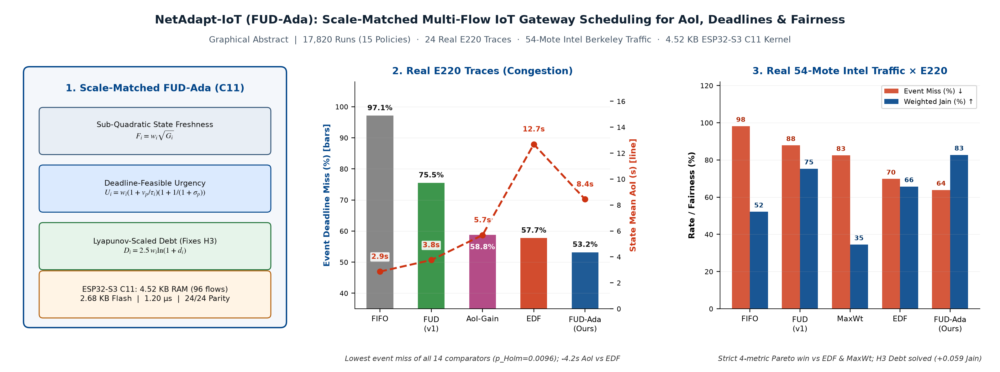
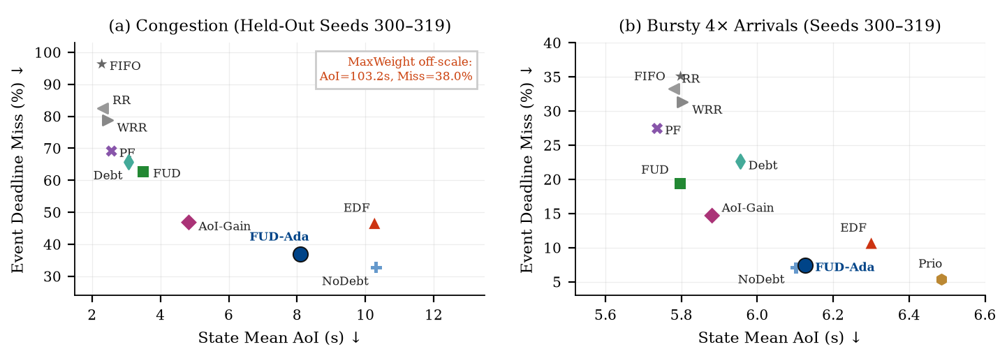
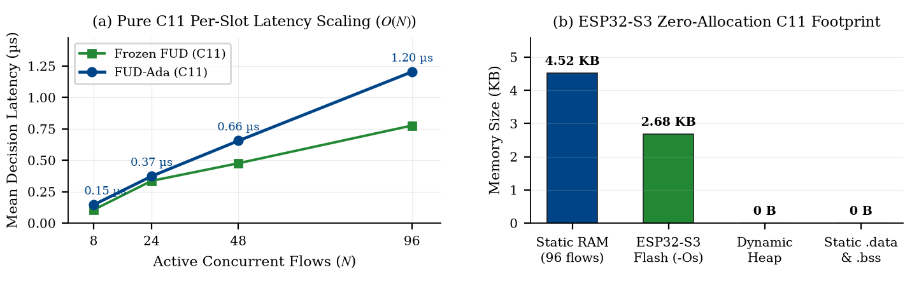
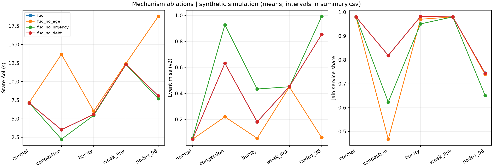

<h1 align="center">NetAdapt-IoT</h1>

<p align="center"><strong>面向多业务 IoT 共享网关出口的自适应调度研究</strong></p>

<p align="center">信息年龄 AoI · 截止期感知调度 · 公平资源分配</p>

---

<p align="center">
  <a href="#project-overview">概览</a> ·
  <a href="#phase-2-upgrade">Phase 2（FUD-Ada 与 C11）</a> ·
  <a href="#research-question-and-method">研究方法</a> ·
  <a href="#key-findings">实验结果</a> ·
  <a href="#implementation-status">实现状态</a> ·
  <a href="#quick-start">快速开始</a> ·
  <a href="papers/netadapt-iot/manuscript.pdf">IEEE 论文</a> ·
  <a href="README.md">English</a>
</p>

---

<a id="project-overview"></a>

NetAdapt-IoT 是一个面向多业务 IoT 网络的资源调度研究平台，研究多个设备共享有限通信出口时，如何在状态更新的新鲜度、事件截止期和设备服务公平性之间分配资源。

项目跨越两个完整审计阶段（**累计 17,820 次运行、15 种调度策略**）：

- **冻结 v1 基准（`12,480` 次，seeds `100–119`）**：Python 离散时隙模型、9 种经典基线（`FIFO`、`RR`、`WRR`、`EDF`、`Priority`、`MaxWeight`、`PF`、`AoI-Gain`、`Debt`）、冻结版 `FUD`（带 AST 哈希锁）及 3 项分量消融，覆盖 48 条命名条件。
- **Phase 2 全面升级（`+5,340` 次严格留出运行，seeds `300–319` + 12 个真实日期）**：提出尺度匹配调度器 **`FUD-Ada`**（`src/netadapt/ext/`），从根本上解决 v1 报告中的二次 AoI 失衡与 H3 欠账消融悬案；接入 **24 条真实 ESP32-S3 + E220-400T22D Sub-GHz 硬件丢包日志**（3,359 次实测射频尝试）与 **MIT Intel Berkeley 54 节点真实无线传感网多流负载**；实现 **零动态分配纯 C11 嵌入式内核**（96 流仅占 `4.52 KB` RAM、ESP32-S3 `-Os` 仅 `2.68 KB` Flash、`24/24` 轨迹位级一致）；并输出独立 **IEEEtran 论文**（[manuscript.pdf](papers/netadapt-iot/manuscript.pdf)）与完整[中文技术报告](docs/PHASE2_HARDWARE_REALDATA_C11_ZH.md)。

<a id="phase-2-upgrade"></a>

## Phase 2：尺度匹配 `FUD-Ada`、真实硬件丢包、54 节点真实流量与纯 C11 内核

冻结版 `FUD`（`src/netadapt/scheduler.py` 保持 100% 不可变以通过 AST SHA-256 锁校验）在 [research/REPORT.md](research/REPORT.md) 中暴露了两个核心短板：（1）拥塞下二次状态项 $w_i G_i(t)$ 膨胀至 $13\text{--}38$，淹没了有界事件紧迫度（$\approx 6.7$）；（2）未缩放线性欠账项（$0.25\,d_i \approx 0.1$）导致 H3 公平性消融跨零无结论（$+0.00052$）。

**`FUD-Ada`**（`src/netadapt/ext/adaptive_scheduler.py`，在独立校准集 `200–204` 冻结 $\alpha_u=1.0, \beta_d=2.5$）以亚二次状态新鲜度 $w_i\sqrt{G_i(t)}$、截止期余量紧迫度放大 $w_i(1+v_p/\tau_i)(1+\alpha_u/(1+\sigma_p^+))$ 与 Lyapunov 对数欠账 $\beta_d w_i \ln(1+d_i(t))$ 同时根治上述两大问题。



### 留出集核心结果（5,340 次运行，全局 Holm-Bonferroni 校正）

| 评测队列 | 策略 | 事件 Miss (%) ↓ | 状态平均 AoI (s) ↓ | 原始 Jain ↑ | 加权 Jain ↑ |
| :--- | :--- | ---: | ---: | ---: | ---: |
| **合成拥塞**（20 留出种子） | `FIFO` | 96.32 | 2.28 | 0.7167 | 0.5499 |
| | `EDF` | 46.54 | 10.27 | 0.7101 | 0.8975 |
| | `AoI-Gain` | 46.84 | 4.83 | 0.7443 | 0.9600 |
| | `MaxWeight` | 37.95 | 103.24 | 0.5822 | 0.5033 |
| | `FUD`（冻结 v1） | 62.75 | 3.50 | 0.8201 | 0.9560 |
| | **`FUD-Ada`（本文）** | **36.92** | **8.09** | **0.6293** | **0.8089** |
| **真实 E220 硬件日志**（24 条，拥塞） | `FIFO` | 97.11 | 2.87 | 0.7167 | 0.5499 |
| | `EDF` | 57.72 | 12.69 | 0.7101 | 0.8975 |
| | `AoI-Gain` | 58.79 | 5.68 | 0.7505 | 0.9680 |
| | `FUD`（冻结 v1） | 75.49 | 3.76 | 0.8126 | 0.9124 |
| | **`FUD-Ada`（本文）** | **53.17** | **8.44** | **0.6650** | **0.8622** |
| **真实 54 节点 Intel × E220**（12 天） | `FIFO` | 98.18 | 19.16 | 0.6564 | 0.5214 |
| | `EDF` | 69.80 | 53.05 | 0.5826 | 0.6572 |
| | `MaxWeight` | 82.51 | 81.99 | 0.4706 | 0.3451 |
| | `AoI-Gain` | **61.72** | **22.15** | 0.7004 | 0.9113 |
| | `FUD`（冻结 v1） | 87.84 | 19.19 | 0.6338 | 0.7528 |
| | **`FUD-Ada`（本文）** | **63.86** | **24.01** | **0.6666** | **0.8275** |

- **全基线最低事件 Miss**：在合成拥塞（`36.92%`）、4 倍突发（`7.42%`）与 **24 条真实 E220 硬件丢包日志**（`53.17%`）下，均在全部 14 个对比策略中取得最低事件截止期错失率（全部 $p_{\text{Holm}}=0.0096$；相对 `EDF` 还把状态 AoI 压低 `−2.18 s` 至 `−4.25 s`，相对冻结 `FUD` 降低 `−22.3` 至 `−25.8 pp`）。
- **真实 54 节点 Intel Berkeley 流量四指标严格帕累托碾压 `EDF` 与 `MaxWeight`**：相对 `EDF` 实现事件 Miss `−5.94 pp`、状态 AoI `−29.03 s`（`−54.7%`）、原始 Jain `+0.084`、加权 Jain `+0.170`（全部 $p_{\text{Holm}} \le 0.0392$）。同时如实披露：`AoI-Gain` 在真实异步突发下事件 Miss 与 `FUD-Ada` 统计学打平（`61.72%` vs `63.86%`, $p_{\text{Holm}}=0.927$）且 AoI 略优。
- **彻底终结 H3 欠账消融悬案（`FUD-Ada` vs `FUD-Ada-NoDebt`）**：三大队列全部显著正向——合成拥塞 `+0.0486` 原始 / `+0.0812` 加权 Jain 且 AoI 降 `−2.23 s`（$p_{\text{Holm}}=0.0096$）；真实 E220 `+0.0447` / `+0.0652` Jain 且 AoI 降 `−1.49 s`（$p_{\text{Holm}}=0.0096$）；真实 54 节点 Intel Berkeley `+0.0586` / `+0.0550` Jain（$p_{\text{Holm}}=0.0364$，且无显著事件错失代价 $p_{\text{Holm}}=0.141$）。




### 零动态分配纯 C11 嵌入式内核（`src/netadapt/c11/`）

| 指标（`-std=c11 -Wall -Wextra -Werror`） | 实测值 |
| :--- | :--- |
| 静态 RAM（`sizeof(na_sched_t)`，支持 96 并发流） | **4,624 B（4.52 KB）**，**0 B 堆分配** |
| ESP32-S3 Xtensa `-Os` Flash（`netadapt_sched.o`，8 策略） | **2,746 B（2.68 KB `.text`）**，`0 B .data`，`0 B .bss` |
| 宿主机 $O(N)$ 单时隙决策时延（`FUD-Ada`，`N=8/24/48/96`） | **0.15 / 0.37 / 0.66 / 1.20 µs**（Apple clang `-O2`，5 万次均值） |
| Python–C11 位级轨迹一致性（状态误差 `< 1e-11`） | **24 / 24 全轨迹零偏差**（8 策略 × 3 场景） |



完整 Phase 2 文档：[IEEEtran 英文论文 PDF](papers/netadapt-iot/manuscript.pdf) · [Phase 2 中文技术报告](docs/PHASE2_HARDWARE_REALDATA_C11_ZH.md) · [Phase 2 配对效应 CSV](output/phase2_validation/paired_effects.csv) · [C11 基准 JSON](output/phase2_c11/benchmark.json)。

<a id="research-question-and-method"></a>

## 研究问题与方法

当负载与链路条件变化时，共享 IoT 网关应该怎样安排不同业务的发送顺序，兼顾信息时效、事件截止期与服务公平性？

FUD 的每次调度决策包含三个部分：

1. **信息时效 Freshness：** 交付状态更新后，预期归一化平方 AoI 的下降量。
2. **事件紧迫度 Urgency：** 事件包的剩余截止期余量与等待时间。
3. **服务欠账 Debt：** 积压业务流累积的服务需求。

调度器结合三个分量、基于 ACK 的成功率估计和包服务成本，选择满足预算的队首包。三个分量系数为 `1 / 1 / 0.25`。对于 `N` 条业务流，每次决策扫描的复杂度为 `O(N)`，队列过期处理另计。

状态流保留最新待发更新，事件流使用有限 FIFO。Token 桶管理通信预算，共享服务器每次完成一个不可抢占的传输。


默认仿真采用 100 ms 时隙、64 B payload、16 B 抽象头部和 6,400 bit/s 有效服务率，Token 桶容量为四个服务时隙。[方法说明](research/design/proposal.md)给出了评分公式、队列规则、时间顺序和指标定义。

## 基线与实验设计

| 方法 | 调度依据 |
| --- | --- |
| `fifo` | 最早产生且满足预算的队首包 |
| `rr` / `wrr` | 轮询 / 加权轮询 |
| `edf` / `priority` | 最早截止期 / 固定业务优先级 |
| `maxweight` / `pf` | 队列压力 / 比例公平 |
| `aoi_gain` / `debt` | 信息时效收益 / 累积服务欠账 |
| `fud` | 结合信息时效、紧迫度与欠账 |
| `fud_no_age` / `fud_no_urgency` / `fud_no_debt` | 分别去除一个分量的消融实验 |

每组场景与种子下，13 种方法使用相同的输入流量、按绝对时刻索引的潜在信道结果、队列规则和资源预算。调度依据包括包时间戳、队列状态与历史 ACK 观测。

15 个场景覆盖正常负载、拥塞、8/24/48/96 个逻辑设备、异构产生率、等优先级、弱链路、Markov 损失、突发、预算变化、反馈延迟、异包长和无损服务。

评价体系分别报告状态 AoI、替换率和发送成功率，以及事件及时交付、溢出和过期。资源公平性采用实际占用的抽象服务 slots，并给出等份和权重比例参考。各方法共享主窗口与停止到达后的公共尾窗，主截止点快照与最终结局分别记录。数学定义和控制条件见[指标文档](docs/metrics-v2.md)、[实验协议](research/experiments/protocol.md)与[冻结配置](configs/refined_v1/)。

<a id="key-findings"></a>

## 主要发现：精修版软件评估

主实验 3,900 次、固定总负载组 1,040 次、敏感性组 6,500 次、高负载桶容量组 1,040 次；每条条件均使用 seeds 100–119 和全部 13 种方法。敏感性各组保留自己的基准水平，重复基准在组内分析。状态 AoI 与 Service Share 仅统计主观察窗口，事件结局追踪至公共尾窗结束。

| 场景 | 方法 | 状态平均 AoI(s) ↓ | 事件 miss(%) ↓ | Jain Service Share ↑ |
| --- | --- | ---: | ---: | ---: |
| 拥塞 | FIFO | 2.2841 | 96.42 | 0.7159 |
| 拥塞 | AoI-gain | 4.8532 | 47.31 | 0.7441 |
| 拥塞 | FUD | 3.5046 | 63.15 | 0.8187 |
| 突发 | FIFO | 5.5966 | 33.91 | 0.9751 |
| 突发 | AoI-gain | 5.6617 | 13.83 | 0.9808 |
| 突发 | FUD | 5.5926 | 18.13 | 0.9818 |

**拥塞：** FUD−FIFO 的事件 miss 差为 -33.27238 [-33.59573, -32.98051] 个百分点，状态 AoI 差为 +1.22049 [+1.20904, +1.23202] s（95% 配对 bootstrap CI）。相对 AoI-gain，FUD 的事件 miss 更高、状态 AoI 更低。

**欠账消融：** 拥塞下 Service Share Jain 的变化为 +0.00052 [-0.00074, +0.00171]，区间跨零，该条件的资源公平性提升尚无明确方向。

**规模与模型控制：** A 组固定每流速率，B 组在 8/24/48/96 条流之间保持总负载和分类到达相同；桶容量 2/4/8/16 与其余七组参数检验适用条件。[A–K 报告](research/REPORT.md)给出五项研究问题、完整比较区间及有利和不利结果。




完整数据：[汇总](output/study_refined_v1/summary.csv) · [配对比较](output/study_refined_v1/paired_differences.csv) · [每流指标](output/study_refined_v1/per_flow.csv) · [不利方向](output/study_refined_v1/negative_results.csv) · [固定总负载](output/study_refined_v1/scaling/results.md) · [敏感性](output/study_refined_v1/sensitivity/results.md) · [高负载桶容量](output/study_refined_v1/bucket_load/results.md)。历史 v1 数据保留在 [output/study](output/study/results.md)。

<a id="implementation-status"></a>

## 实现状态

| 模块 | 进展 |
| --- | --- |
| 冻结 v1 队列、公共尾窗与 13 种策略 | 已实现；`scheduler.py` 保持 AST 哈希锁不变 |
| Phase 2 尺度匹配 `FUD-Ada` 与 `FUD-Ada-NoDebt` | 已实现于 `src/netadapt/ext/`；三大队列全部解决 H3 欠账消融 |
| 零动态分配纯 C11 网关内核（8 策略、96 流） | `4.52 KB` RAM、`2.68 KB` ESP32-S3 `-Os` Flash、`24/24` 轨迹一致 |
| 软件与真实轨迹实验 | **累计 17,820 次**（v1 `12,480` + Phase 2 `5,340`），0 失败 |
| 真实 E220 硬件日志与 54 节点 MIT Intel Berkeley 流量 | 24 条实测 E220 日志（`3,359` 次尝试）+ 12 个留出日真实传感网流量 |
| Python + C11 单元、一致性与集成测试 | **74 项测试全部通过**（v1 `48` 项 + Phase 2 / C11 `26` 项） |
| 原始日志审计与历史基线保留 | 12,480 次 v1 全量审计通过；40,111 个历史文件原样保留 |
| ESP32-S3 N16R8 固件与独立 IEEEtran 论文 | 双端固件编译核对通过；7 页 IEEE 论文 PDF 与 Graphical Abstract 编译完成 |
| 物理多节点 MAC 竞争与示波器实测功耗 | 下一阶段 |

硬件路径使用两块 ESP32-S3 和两套 E220-400T22S，PC 安排逻辑流发送顺序，接收端校验 CRC 并返回 ACK。接线与运行见[硬件指南](hardware/README.md)，构建与软件证据见[验证记录](docs/validation/status.md)。

<a id="quick-start"></a>

## 快速开始与复现

使用 Python 3.11 或更新版本，从项目目录创建环境：

```bash
python3 -m venv .venv
source .venv/bin/activate
python -m pip install -e '.[dev,hardware]'
python -m pytest -q
```

运行包含 78 次仿真的软件示例，并生成报告：

```bash
python run.py run --config configs/refined_v1/pilot.json --out output/quickstart --workers 2
python run.py analyze --out output/quickstart
```

运行主实验矩阵：

```bash
python run.py run --config configs/refined_v1/main.json --out output/reproduction --workers 4
python run.py analyze --out output/reproduction
```

固定总负载和敏感性的完整命令见[复现指南](docs/reproducibility.md)。

每个新实验使用新输出目录；源码 hash 与配置一致时，可恢复已有实验。`hardware` extra 包含串口协议测试依赖和 PlatformIO。

审计复现数据、运行 Phase 2 真实轨迹与 C11 基准测试，或构建固件：

```bash
python scripts/audit_refined.py output/reproduction
python scripts/benchmark_c11_footprint.py
python scripts/run_phase2_real_validation.py --workers 6
python papers/netadapt-iot/build_figures.py
pio run -d hardware/firmware
```

每次运行保存配置、种子、源码/轨迹 hash、逐包结局和调度决策。分析生成 CSV 汇总、配对 bootstrap 区间、PNG 图表和 Markdown 报告。环境信息记录在[requirements-lock.txt](requirements-lock.txt)和实验 [manifest](output/study_refined_v1/manifest.json)中。

仓库包含实验汇总、每流统计、报告和图表。逐包日志与历史源码快照保存在本地输出目录，运行上述配置可重新生成逐包记录。

## 相关研究项目

| 项目 | 研究重点 |
| --- | --- |
| [TAIS](https://github.com/Sver0411/TAIS) | ESP32-S3/E220 信任感知节点级闭环自适应感知与可靠传输 |
| [AdaptiveSense](https://github.com/Sver0411/AdaptiveSense) | 变化感知采样与上传决策 |
| [SensorTrust](https://github.com/Sver0411/SensorTrust) | 传感器健康评估与故障检测 |
| [EventGuard-LoRa](https://github.com/Sver0411/EventGuard-LoRa) | 关键事件交付与有界通信冗余 |
| [Smart-Agriculture-Edge-AI](https://github.com/Sver0411/Smart-Agriculture-Edge-AI) | 多节点感知、边缘决策与离线恢复 |

NetAdapt-IoT 聚焦网络级服务顺序，固定源端产生行为，研究多个设备与业务流如何共享通信机会。

## 文档与开发路线

| 主题 | 文档 |
| --- | --- |
| 独立 IEEEtran 英文论文 | [论文 PDF](papers/netadapt-iot/manuscript.pdf) · [LaTeX 源码](papers/netadapt-iot/manuscript.tex) · [Graphical Abstract](papers/netadapt-iot/graphical_abstract.png) |
| Phase 2 技术报告与数据 | [Phase 2 中文报告](docs/PHASE2_HARDWARE_REALDATA_C11_ZH.md) · [Phase 2 汇总 CSV](output/phase2_validation/summary.csv) · [C11 基准](output/phase2_c11/benchmark.json) |
| 方法与数学定义 | [研究方案](research/design/proposal.md) · [FUD-Ada 调度器](src/netadapt/ext/adaptive_scheduler.py) |
| 实验设计 | [实验协议](research/experiments/protocol.md) · [配置](configs/refined_v1/main.json) · [E220 硬件日志](configs/e220_hardware_traces.json) |
| 软件结构 | [架构说明](docs/architecture.md) · [C11 调度内核](src/netadapt/c11/netadapt_sched.h) |
| 结果与数据（冻结 v1） | [A–K 报告](research/REPORT.md) · [结果报告](output/study_refined_v1/results.md) · [统计 CSV](output/study_refined_v1/summary.csv) |
| 复现与审计 | [复现指南](docs/reproducibility.md) · [审计记录](output/study_refined_v1/audit.json) |
| 硬件与开发 | [硬件指南](hardware/README.md) · [路线图](docs/roadmap.md) |

下一阶段的开发重点：

- 在 ESP32-S3/E220 链路上校准单帧传输、ACK 时序与有效服务率。
- 将共享逻辑流负载重放到物理通信出口。
- 扩展独立发送节点与网络接入控制实验。
- 评估更长流量轨迹、更多调度方法及实际通信能耗。
