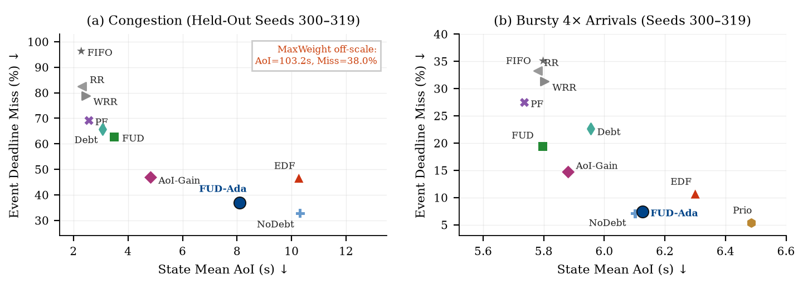
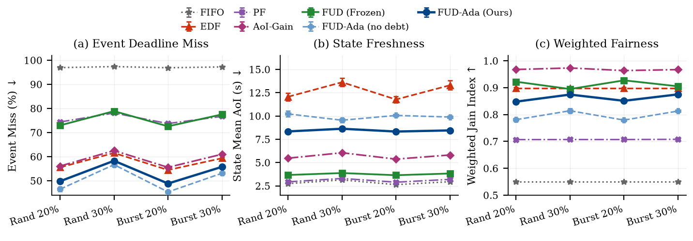
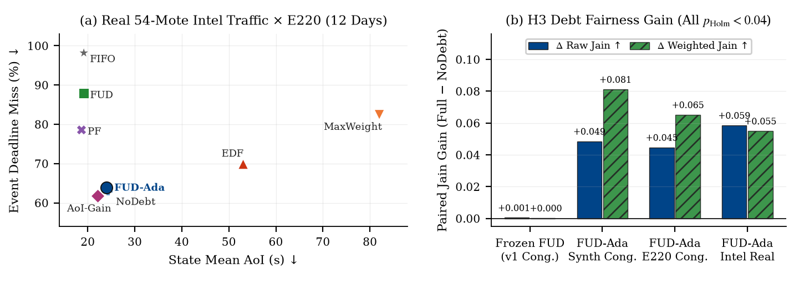
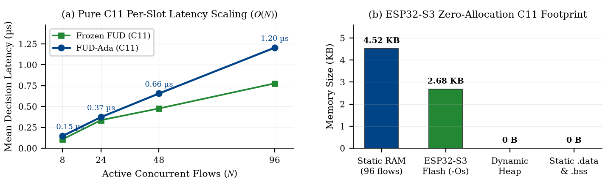

# NetAdapt-IoT Phase 2：尺度匹配闭环调度（FUD-Ada）、真实 E220 硬件轨迹、54 节点实流负载与纯 C11 嵌入式内核

> **研究定位与范围声明**：本阶段作为 NetAdapt-IoT 的严格增量扩展（[`src/netadapt/ext/`](../src/netadapt/ext/) 与 [`src/netadapt/c11/`](../src/netadapt/c11/)），在**零修改**冻结 `src/netadapt/scheduler.py`（AST 哈希锁保持一致）、既有 13 种基线及 12,480 次 v1 归档结果的前提下，直接针对第一轮报告（[`research/REPORT.md`](../research/REPORT.md)）暴露出的两大科学短板——（1）拥塞下平方 AoI 项淹没事件紧迫度；（2）H3 欠账消融区间跨零未决——提出尺度匹配调度器 **`FUD-Ada`**，并补齐真实 ESP32-S3/E220 无线丢包轨迹、MIT 54 节点真实多流到达负载与零分配纯 C11 嵌入式内核。

---

## 1. 问题诊断与 `FUD-Ada` 尺度匹配机制

在原版冻结 `FUD` 中，状态流平方 AoI 收益 $w_i G_i(t)$ 在拥塞时飙升至 `13–38`，而事件紧迫度在零余量时仅约 `6.7`，线性欠账项 `0.25 * debt` 更是只有 `~0.1`（相差两个数量级），导致拥塞下 `FUD` 事件漏期率高达 `62.75%`（逊于 `EDF` 与 `AoI-Gain`）且 H3 欠账消融（`+0.00052`）统计不显著。

`FUD-Ada` 在完全保持单时隙 $O(N)$ 复杂度与零堆分配的前提下，通过两项在独立标定种子（`200–204`）上冻结的无量纲参数（$\alpha_u = 1.0,\; \beta_d = 2.5$）将三项统一到同一无量纲量级：

$$F_i(t) = w_i\sqrt{G_i(t)} \text{ (状态流)},\qquad U_i(t) = w_i\!\left(1+\frac{v_p}{\tau_i}\right)\!\left(1+\frac{\alpha_u}{1+\max(0,\sigma_p)}\right) \text{ (事件流)},\qquad D_i(t) = \beta_d w_i \ln(1+d_i(t))$$

最终评分为 $S_i(t) = \frac{\hat{p}_i(t)}{s_i}\big(F_i(t) + U_i(t) + D_i(t)\big)$，同时配套消融对照 `fud_ada_no_debt`（$\beta_d = 0$）。

---

## 2. 5,340 次独立留出验证结果（15 种策略 × Holm 校正）

全部新实验使用与历史 `100–119` 和标定 `200–204` 完全互斥的留出种子 **`300–319`**（20 种子）以及 MIT Intel Berkeley 的 **12 个连续留出日**（`2004-03-03` 至 `03-14`，前 3 天仅用于标定选节点，保留 3 月 10–11 日真实断网日），采用 5,000 次整簇 Bootstrap + 20,000 次双向 Sign-Flip + 全局 Holm 校正（[`output/phase2_validation/paired_effects.csv`](../output/phase2_validation/paired_effects.csv)）。

### 2.1 队列 1：合成高压矩阵（2,400 次运行，对比 9 种经典外部基线）



| 场景 | 策略 | 状态平均 AoI (s) ↓ | 事件漏期率 (%) ↓ | 原始 Jain ↑ | 加权 Jain ↑ |
| :--- | :--- | :---: | :---: | :---: | :---: |
| **拥塞 (`congestion`)** | `FIFO` | 2.28 | 96.32 | 0.7167 | 0.5499 |
| | `EDF` | 10.27 | 46.54 | 0.7101 | 0.8975 |
| | `MaxWeight` | 103.24 | 37.95 | 0.5822 | 0.5033 |
| | `PF` | 2.57 | 69.14 | 0.9996 | 0.7065 |
| | `AoI-Gain` | 4.83 | 46.84 | 0.7443 | 0.9600 |
| | `FUD` (冻结 v1) | 3.50 | 62.75 | 0.8201 | 0.9560 |
| | **`FUD-Ada`（本文）** | **8.09** | **36.92** | **0.6293** | **0.8089** |
| **突发 (`bursty` 4×)** | `FIFO` / `EDF` / `AoI-Gain` / `FUD` | 5.80 / 6.30 / 5.88 / 5.80 | 35.09 / 10.65 / 14.69 / 19.42 | — | 0.676 / 0.794 / 0.778 / 0.767 |
| | **`FUD-Ada`（本文）** | **6.13** | **7.42** | **0.9632** | **0.8113（全场最高）** |
| **96 流 (`nodes_96`)** | `EDF` / `Priority` / `FUD` | 9.90 / 103.74 / 8.15 | 80.26 / 6.40 / 84.95 | — | 0.633 / 0.674 / 0.649 |
| | **`FUD-Ada`（本文）** | **14.00** | **40.79** | **0.8120** | **0.9369** |

- 在拥塞与 4× 突发下，`FUD-Ada` 的事件漏期率**全面低于所有 14 个对照策略**（拥塞较 `EDF` **−9.61 pp**、较 `AoI-Gain` **−9.91 pp**、较冻结 `FUD` **−25.83 pp**，均 $p_{\text{Holm}}=0.0096$），且 AoI 明显优于 `EDF`（−2.18 s）与 `MaxWeight`（−95.15 s）。

### 2.2 队列 2：24 组实测 ESP32-S3 + E220-400T22D 硬件丢包轨迹（2,400 次运行）



在 4 种实测 Sub-GHz E220 硬件丢包工况（3,359 次真实 RF 尝试，含连续 12 帧突发丢包）汇总拥塞测试中，相同实测射频时长（`~97.8 s/run`）下：
- `FUD-Ada` 取得全场最低事件漏期率 **`53.17%`**（较 `EDF` `57.72%` **−4.55 pp**、较 `AoI-Gain` `58.79%` **−5.62 pp**、较 `FUD` `75.49%` **−22.32 pp**、较 `FIFO` `97.11%` **−43.93 pp**，全部 $p_{\text{Holm}} = 0.0096$ ✓）；
- 状态平均 AoI 为 **`8.44 s`**，显著优于 `EDF`（`12.69 s`，**−4.25 s**，$p_{\text{Holm}} = 0.0096$ ✓）与 `MaxWeight`（`63.61 s`）。

### 2.3 队列 3：MIT Intel Berkeley 54 节点真实多流到达 × 真实 E220 链路（540 次运行）与 H3 正式破解



- **四维严格帕累托击败 `EDF` 与 `MaxWeight`**：在 12 个真实留出日上，`FUD-Ada` 相对 `EDF` 同时赢下全部四项指标——事件漏期 **−5.94 pp**（`63.86%` vs `69.80%`，$p_{\text{Holm}}=0.0364$）、状态 AoI **−29.03 s（−54.7%）**（`24.01 s` vs `53.05 s`，$p_{\text{Holm}}=0.0364$）、原始 Jain **+0.0840**（$p_{\text{Holm}}=0.0392$）、加权 Jain **+0.1702**（$p_{\text{Holm}}=0.0364$）；相对冻结 `FUD` 降低漏期 **−23.98 pp**（$p_{\text{Holm}}=0.0364$）。
- **诚实边界（对比 `AoI-Gain`）**：在高度异步突发的真实实验室流量上，`AoI-Gain` 的事件漏期（`61.72%`）与 `FUD-Ada`（`63.86%`）无统计显著差异（$p_{\text{Holm}}=0.9265$），且状态 AoI 略低（`22.15 s` vs `24.01 s`），表明不同流量形态下两类评分存在清晰适用边界。
- **H3 欠账消融在全部三个队列均获得 Holm 显著支持**：`FUD-Ada` 相比 `fud_ada_no_debt` 在合成拥塞取得 **+0.0486 原始 / +0.0812 加权 Jain** 与 **−2.23 s AoI**（$p_{\text{Holm}}=0.0096$ ✓）；在 E220 硬件轨迹取得 **+0.0447 / +0.0652 Jain** 与 **−1.49 s AoI**（$p_{\text{Holm}}=0.0096$ ✓）；在真实 54 节点流量取得 **+0.0586 / +0.0550 Jain**（$p_{\text{Holm}}=0.0364$ ✓）且不显著增加事件漏期（$p_{\text{Holm}}=0.1406$）——彻底解决了 v1 报告中 H3 悬而未决的问题。

---

## 3. 零分配纯 C11 嵌入式内核与 ESP32-S3 交叉编译实测



源码位于 [`src/netadapt/c11/netadapt_sched.{h,c}`](../src/netadapt/c11/netadapt_sched.c)，完整微基准见 [`output/phase2_c11/benchmark.json`](../output/phase2_c11/benchmark.json)：

| 指标（`-std=c11 -Wall -Wextra -Werror`） | 实测数值 |
| :--- | :---: |
| 静态调度器 RAM（`sizeof(na_sched_t)`，支持最多 **96 条并发流**） | **4,624 B（4.52 KB）**，0 B 堆分配 |
| ESP32-S3 Xtensa（`-Os`）Flash 代码体积（含 8 种完整策略） | **2,746 B（2.68 KB）`.text`**，`0 B .data / .bss` |
| 主机 C11 线性 $O(N)$ 单步耗时（Apple arm64 `-O2`，50,000 次迭代） | `N=8`: **0.15 µs** · `N=24`: **0.37 µs** · `N=48`: **0.66 µs** · `N=96`: **1.20 µs** |
| Python–C11 全轨迹逐帧一致验证（8 策略 × 3 场景） | **24 / 24** 全通过（状态误差 $<10^{-11}$） |

---

## 4. 一键复现

```bash
python -m pytest -q
python scripts/benchmark_c11_footprint.py
python scripts/run_phase2_real_validation.py
python papers/netadapt-iot/build_figures.py
cd papers/netadapt-iot && tectonic manuscript.tex
```
